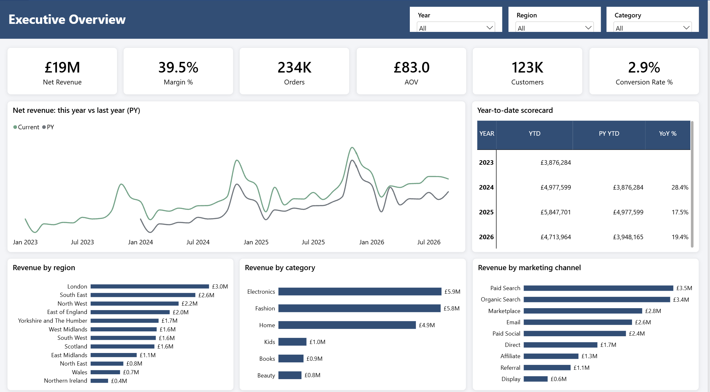
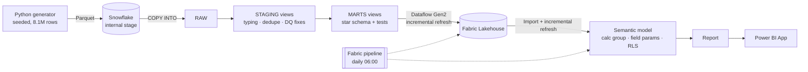
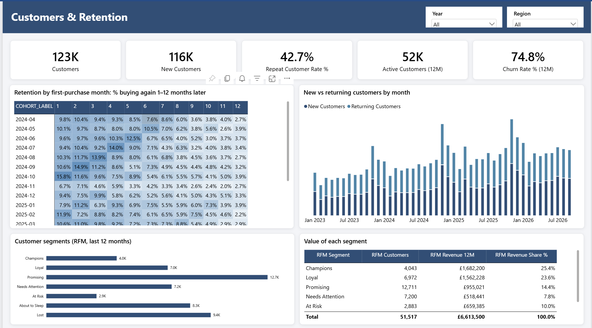
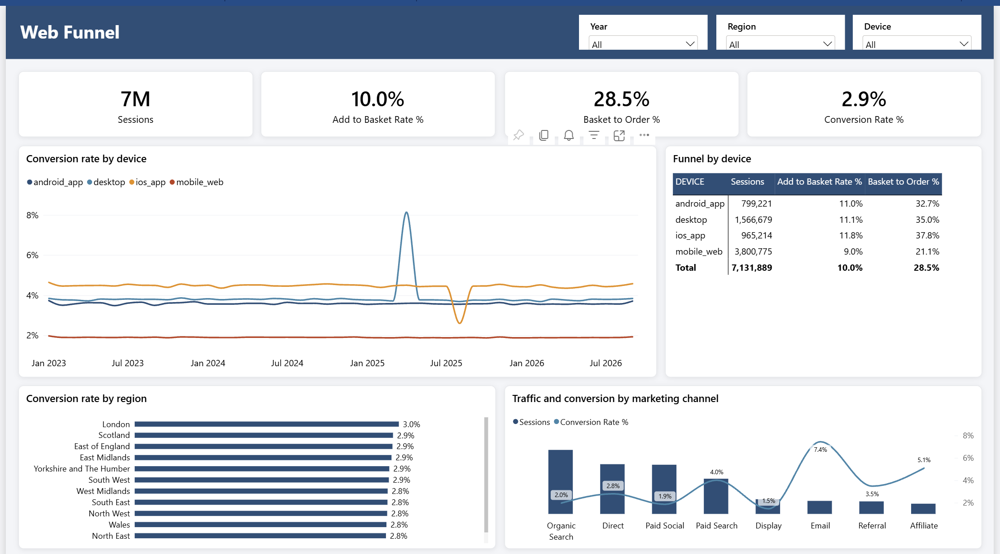

# UK E-commerce Analytics: Snowflake → Microsoft Fabric → Power BI

An end-to-end analytics build for a fictional UK online retailer: 8.1 million rows of realistic synthetic data move through a Snowflake warehouse and a Microsoft Fabric pipeline with incremental refresh into a secured Power BI model and report, delivered to regional managers as a Power BI App.



## Results at a glance

| | |
|---|---|
| **Data** | 8.1M rows across 9 source tables (orders, sessions, returns, marketing…), Jan 2023 – Sep 2026 |
| **Data quality** | 7 planted source-data issues found and repaired in STAGING; a test-data trap (1,500 fake orders) found and quantified; 31 automated MARTS tests |
| **Dataflow refresh** | **21 min → 3 min** with incremental refresh (monthly buckets, change detection) |
| **Model refresh** | **2 min 13 s → 26 s** incremental; full refresh **halved** after tuning |
| **Model size** | **756 MB → 56 MB (−93%)** after VertiPaq analysis |
| **Security** | Dynamic row-level security: one role and one security table, so managers see only their region |
| **Delivery** | 5-page report and Power BI App; a daily Fabric pipeline chains dataflow → model refresh |
| **Insights** | 7 business stories found in the data, e.g. a promotion with 1.2× ROAS but **−77% ROI** ([insights](docs/insights.md)) |

## Architecture



| Layer | What happens | Key techniques |
|---|---|---|
| **Generate** | Seeded Python generator writes Parquet, with realistic seasonality, cohorts, campaigns and planted problems | NumPy/pandas/PyArrow, reproducible seeds |
| **Load** | Key-pair-authenticated service user PUTs files to an internal stage and runs an idempotent `COPY INTO` | `MATCH_BY_COLUMN_NAME`, load metadata, resource monitor |
| **STAGING** | One view per source table: types, deduplication, repairs; every fix is flagged, never silently dropped | `QUALIFY ROW_NUMBER()`, `TRY_TO_TIMESTAMP`, DQ scorecard view |
| **MARTS** | Star schema: 4 facts, 7 dimensions, `-1` unknown members, last-non-direct-click attribution (30-day look-back) | 31 automated tests: row counts, unique/orphan keys, reconciliation |
| **Fabric** | Dataflow Gen2 into a Lakehouse; incremental refresh on the two large facts | Monthly buckets, separate filter and change-detection columns |
| **Model** | Import model with its own incremental refresh policy | Calculation group (10 time-intelligence items), field parameters, RFM calculated table, cohorts, dynamic RLS |
| **Deliver** | Report (PBIR, light corporate theme) → App; pipeline orders the refreshes | App audiences, Viewer-only access, refresh orchestration |

## Report

| Page | Answers |
|---|---|
| **Executive Overview** | How is the business doing? KPIs, this year vs last year, YTD scorecard |
| **Sales & Products** | What sells and what comes back? Top 10 products, interactive sales-mix explorer, return reasons |
| **Customers & Retention** | Who comes back? Cohort heat-map, new vs returning, churn, RFM segments |
| **Marketing & Campaigns** | Is spend paying off? ROAS vs margin ROI, last-click vs acquisition attribution |
| **Web Funnel** | Where do visitors drop out? Sessions → basket → order by device, region and channel |

<p>


</p>

## What I found

| Story | Finding | Recommendation |
|---|---|---|
| Spring sale | +86% orders, but margin fell 41% → 31% and demand was pulled forward: **ROI −77%** despite 1.2× ROAS | Judge promotions on margin ROI, net of pull-forward |
| Faulty earbuds | #2 product's return rate **5.8% → 31.7%** after a supplier change; 90% "faulty" | Quality hold and supplier claim |
| NI surcharge | Northern Ireland conversion **−28%** after a £4.95 delivery charge; baskets unchanged | Test a free-delivery threshold for NI |
| Black Friday cohort | Largest cohort of the year, but month-3 retention **4.6%** vs 10–14% | Target lifetime value, not new-customer volume |
| iOS checkout bug | iOS conversion **4.5% → 1.8%** for three weeks while baskets were normal | Device-level conversion alerts |
| Delivery threshold | £40–60 baskets fell **16.6% → 5.0%**; AOV up, low-value customers ordering less | Read AOV together with frequency |
| Test data in production | 1,500 £1 orders from 25 QA accounts doubled orders for a week | Flag in STAGING, exclude in MARTS, test for it (fix designed, not applied) |

Full write-up with tables: **[docs/insights.md](docs/insights.md)**.

## Engineering decisions worth noting
- **Push logic upstream.** Revenue, VAT, margin and attribution are calculated once in Snowflake, so DAX stays simple (SUM / DIVIDE) and every tool gets the same numbers.
- **Never drop rows silently.** STAGING repairs set `is_*` flags and a DQ scorecard counts them. MARTS tests reconcile totals back to STAGING to the penny.
- **Incremental refresh needs two columns.** Partitions are filtered on the business timestamp; changes are detected on `loaded_at`. Deletions in old periods aren't detected, which is why the test-data fix needs a forced reload.
- **Tune with evidence.** VertiPaq Analyzer showed that two unused, unique-per-row columns were 91% of the model. Removing them after the refresh filter cut the size by 93% without changing any number ([performance](docs/performance.md)).
- **Security as data.** One RLS role reads a security table with `USERPRINCIPALNAME()`; giving someone access is a row in Snowflake, not a model change ([security](docs/security_and_refresh.md)).
- **Everything in Git.** The model (TMDL) and report (PBIR) are saved as PBIP text files, so every measure and visual change is reviewable in a pull request.

## Repository

| Path | Contents |
|---|---|
| [`generator/`](generator/) | Seeded Python data generator and validation |
| [`loader/`](loader/) | Key-pair setup and idempotent Snowflake loader |
| [`snowflake/`](snowflake/) | SQL in run order: setup → RAW → STAGING → DQ → MARTS → tests → service users → RLS table |
| [`pbip/`](pbip/) | Power BI Project: semantic model (TMDL) and report (PBIR) |
| [`tools/`](tools/) | Report builder, PBIR schema validator, VertiPaq/Performance Analyzer summaries, read-only SQL helpers |
| [`docs/`](docs/) | Design and results write-ups (below) |

**Docs:** [data model](docs/data_model.md) · [data dictionary](docs/data_dictionary.md) · [Fabric dataflow](docs/fabric_dataflow.md) · [semantic model](docs/semantic_model.md) · [DAX: customers](docs/dax_customers.md) · [DAX: advanced](docs/dax_advanced.md) · [report](docs/report.md) · [security & refresh](docs/security_and_refresh.md) · [performance](docs/performance.md) · [insights](docs/insights.md)

## Running it

<details>
<summary>Generate, load and build</summary>

```bash
# 1. Generate data (Windows, Git Bash). Output goes to data/raw/ (git-ignored)
python -m venv .venv
.venv/Scripts/python -m pip install -r generator/requirements.txt
.venv/Scripts/python generator/generate.py --scale 0.0125   # ~100k rows, a few seconds
.venv/Scripts/python generator/generate.py                  # full 8.1M rows, ~30 s
.venv/Scripts/python generator/validate.py

# 2. Snowflake: run snowflake/01_setup.sql and 02_raw_tables.sql, create the loader key, then load
.venv/Scripts/python loader/make_keypair.py                        # then run 03_loader_user.sql
cp .env.example .env                                                # fill in the account
.venv/Scripts/python loader/load_to_snowflake.py

# 3. Run snowflake/04 → 11 in order. 07 (DQ) and 09 (tests) should show 0 remaining / all PASS
```
Then follow [docs/fabric_dataflow.md](docs/fabric_dataflow.md) for the Lakehouse and dataflow, open `pbip/UK_Ecommerce.pbip` in Power BI Desktop, and see [docs/security_and_refresh.md](docs/security_and_refresh.md) for publishing, RLS, the App and the pipeline.
</details>

---
*All data is synthetic. Customers, products and campaigns are generated; any resemblance to real businesses is coincidental.*
