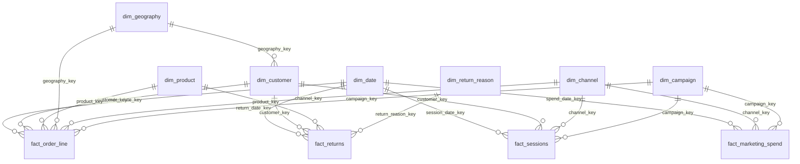

# Data Model Design

## 1. Business context

A fictional UK online retailer that sells general merchandise (Home, Fashion, Electronics, Beauty, Books, Kids). It sells through its **website**, **mobile apps** (iOS/Android) and a **third-party marketplace**, and delivers to all UK regions, including Northern Ireland.

| Item | Value |
|---|---|
| Currency | GBP (£) |
| Data period | 2023-01-01 → 2026-09-30 (45 months) |
| Financial year | April → March (UK convention). FY2025 = Apr 2024 – Mar 2025 |
| Timezone | Europe/London. All timestamps are stored as local time |
| VAT | 20% standard rate; 0% for Books and Kids clothing (zero-rated) |

## 2. Layers

| Layer | Schema | Object type | Purpose |
|---|---|---|---|
| Raw | `UK_ECOM.RAW` | Tables | Data exactly as the source systems sent it. Never edited, only appended. Every row carries `_loaded_at` and `_source_file`. |
| Staging | `UK_ECOM.STAGING` | Views | One view per raw table: cast types, standardise text, dedupe, flag/repair known issues. No joins between sources. |
| Marts | `UK_ECOM.MARTS` | Views | Star schema for Power BI: facts and conformed dimensions, business rules applied. |

Rule: **Power BI only reads MARTS.** Nothing downstream may read RAW or STAGING (this is enforced by the `ECOM_REPORTER` role).

## 3. Source systems → RAW tables

| RAW table | Source system | Approx. rows | Load pattern |
|---|---|---|---|
| `customers` | CRM | 130k | Full snapshot |
| `products` | Product information system (PIM) | 2.5k | Full snapshot |
| `orders` | Order management system (OMS) | 230k | Append by month |
| `order_lines` | OMS | 600k | Append by month |
| `returns` | Returns portal | 70k | Append by month |
| `sessions` | Web/app analytics | 7.0M | Append by month |
| `campaigns` | Marketing calendar | 60 | Full snapshot |
| `marketing_spend` | Ad platforms (daily export) | 15k | Append by month |
| `postcode_areas` | Reference data (static) | 121 | Full snapshot |

**Total ≈ 8M rows.** Sessions dominate, because a realistic conversion rate (~3%) means far more sessions than orders.

## 4. Star schema (MARTS)

### Facts and their grain

The grain is the single most important design decision: it says what one row means.

| Fact | Grain (one row = …) | Key measures |
|---|---|---|
| `fact_order_line` | one product line on one order | quantity, gross sales, discount, net revenue, VAT, COGS, gross margin, allocated shipping |
| `fact_returns` | one returned order line (a line can be part-returned) | quantity returned, refund amount (ex-VAT) |
| `fact_sessions` | one website or app visit | pageviews, added-to-basket flag, converted flag |
| `fact_marketing_spend` | one campaign × channel × day | spend, impressions, clicks |

### Dimensions

| Dimension | One row = … | Notes |
|---|---|---|
| `dim_date` | one calendar day | Built in SQL (not the generator). Has calendar and fiscal (Apr–Mar) attributes. |
| `dim_customer` | one customer | Type 1 (current values only). Holds the cohort month and acquisition channel. |
| `dim_product` | one product (SKU) | Category → subcategory → product hierarchy, list price, unit cost, VAT rate |
| `dim_geography` | one UK postcode area (e.g. `M`, `BT`, `SW`) | Rolls up to region (ITL1) → country. **Used for RLS.** |
| `dim_channel` | one marketing channel | Organic Search, Paid Search, Paid Social, Email, Affiliate, Display, Referral, Direct, Marketplace |
| `dim_campaign` | one campaign | Includes a `-1 "No campaign"` row |
| `dim_return_reason` | one return reason | |
| `security_user_region` | one user × region | Not a dimension: the mapping table for dynamic RLS (Day 12) |

### Key conventions

- **Keys are the source system's natural integer IDs** (`customer_id`, `product_id`, …), renamed to `*_key` in MARTS. MARTS are views, so a sequence-generated surrogate key would not be stable between queries.
- **Date keys are integers in `YYYYMMDD` form** (e.g. `20250314`). They compress well in VertiPaq and are human-readable.
- **Unknown members:** every dimension has a `-1` row ("Unknown" / "Anonymous" / "No campaign"). Facts never hold NULL foreign keys; they point to `-1` instead. This keeps relationships complete and totals correct in Power BI.

## 5. Business rules

These definitions are the contract. DAX measures (Days 9–10) must match them exactly.

### Sales
| Term | Definition |
|---|---|
| **Order** | An OMS order with `status = 'Completed'`. Cancelled orders are excluded from all sales measures but kept in the fact with `is_cancelled = 1`. |
| **Gross sales** | `quantity × unit_price` (inc. VAT, before discount) |
| **Net revenue** | Gross sales − discount, **excluding VAT**. This is the headline "Revenue" everywhere. |
| **COGS** | `quantity × unit_cost` (unit cost from the PIM at the time of the order) |
| **Gross margin** | Net revenue − COGS. Margin % = gross margin / net revenue |
| **Shipping** | Charged per order under the delivery policy in force on the order date. Allocated to lines in proportion to line net revenue. Reported separately, **not** included in net revenue. |
| **AOV** | Net revenue / number of orders |
| **Units per order** | Quantity / number of orders |

### Returns
| Term | Definition |
|---|---|
| **Return window** | 30 days from order date |
| **Return rate (units)** | Units returned / units sold, attributed to the **order** date (so a March order returned in April counts against March) |
| **Refund value** | Refund amount ex-VAT. Net revenue after returns = net revenue − refund value |

### Customers
| Term | Definition |
|---|---|
| **Cohort** | Month of the customer's **first completed order** (not their registration date) |
| **New customer** | A customer whose first completed order falls in the period |
| **Active customer** | At least one completed order in the trailing 365 days |
| **Churned customer** | Was active, but has placed no completed order for 365+ days |
| **Retention (month N)** | Share of a cohort that placed a completed order in month N after the cohort month (M0 = cohort month = 100%) |
| **RFM** | Recency, Frequency and Monetary value over the trailing 365 days, each scored in quintiles (1–5) |
| **Test/internal accounts** | Excluded from all customer and sales measures (see STAGING rules, Day 5) |

### Traffic and marketing
| Term | Definition |
|---|---|
| **Session** | One visit to the website or app. Marketplace orders have no sessions. |
| **Conversion rate** | Converted sessions / sessions (web and app only) |
| **Attribution** | **Last non-direct click** with a 30-day lookback: the order is credited to the most recent non-Direct session's channel and campaign. First-touch is a comparison view (Day 10). |
| **ROAS** | Attributed net revenue / spend |
| **Campaign ROI** | (Attributed gross margin − spend) / spend. Uses margin, not revenue. |

## 6. Security

- Dynamic RLS by **region**: a user sees only the regions mapped to their login in `security_user_region`.
- Head-office users have the row `region = 'ALL'`.
- Built and tested on Day 12 with real test users in the M365 dev tenant.
